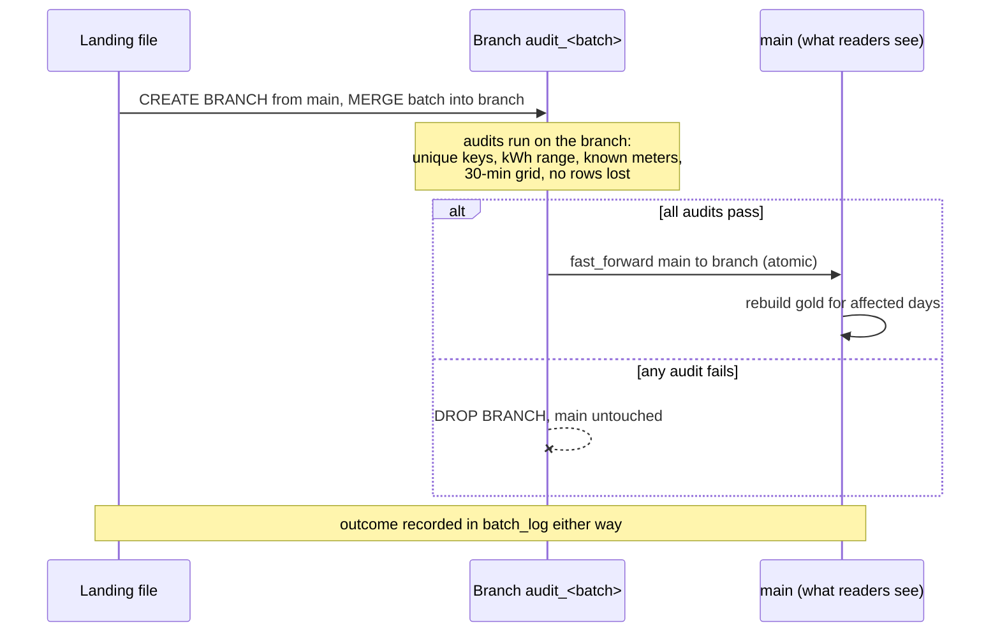

# Write-Audit-Publish on Apache Iceberg

[](https://github.com/kaajjalchoudhary/iceberg-wap-lakehouse/actions/workflows/ci.yml)


A smart-meter pipeline that never lets bad data reach readers. Every batch is written to an
isolated **Iceberg branch**, audited there, and only then **published** to `main` in one atomic
metadata commit. A failed batch is discarded and `main` never sees it.

The feed includes the classic incident: on one day a meter firmware bug reports **Wh as kWh**
(values 1,000x too high). The pipeline rejects that delivery, and the vendor's corrected
re-delivery the next morning goes through cleanly.

## The pattern



| Iceberg feature | How it is used | Where |
|---|---|---|
| **Branches** | Each batch is merged into `audit_<batch>` and audited before anyone can read it | [`wap.py`](meterlake/wap.py), [`ingest.py`](meterlake/ingest.py) |
| **`fast_forward`** | Publishing is a metadata-only, atomic move of `main` | [`wap.py`](meterlake/wap.py) |
| **`MERGE INTO`** | Corrections (higher `revision`) replace readings; stale revisions and duplicates do not | [`ingest.py`](meterlake/ingest.py) |
| **Hidden partitioning** | `months(reading_ts)`: queries filter on the timestamp, never on a partition column | [`tables.py`](meterlake/tables.py) |
| **Partition evolution** | Switched to `days(reading_ts)` mid-stream as volume grew; old files keep their old layout | [`tables.py`](meterlake/tables.py) |
| **Schema evolution** | A new vendor column (`tariff_code`) is added automatically; unknown columns are rejected | [`tables.py`](meterlake/tables.py) |
| **Dynamic partition overwrite** | Gold is rebuilt only for the days a batch touched | [`gold.py`](meterlake/gold.py) |
| **Metadata tables** | `refs`, `snapshots`, `history`, `files` drive publishing, tests and the report | [`report.py`](meterlake/report.py) |
| **Time travel** | Tests read the table as of the previous publish | [`tests/test_pipeline.py`](tests/test_pipeline.py) |
| **Maintenance** | `rewrite_data_files` (also moves old files to the new spec), `rewrite_manifests`, `expire_snapshots` | [`maintenance.py`](meterlake/maintenance.py) |

## Quick start

Requires Python 3.10+ and Java 11 or 17. Spark runs locally and downloads the Iceberg runtime
on first start.

```bash
git clone https://github.com/kaajjalchoudhary/iceberg-wap-lakehouse.git
cd iceberg-wap-lakehouse
python -m venv .venv && source .venv/bin/activate
make install

make run        # 10 days of meter files through Write-Audit-Publish
make maintain   # compaction, manifest rewrite, snapshot expiry
make report     # batches, gold usage, partition specs, snapshots
make test
```

With Docker: `docker build -t meterlake . && docker run --rm -v "$PWD/lake:/data/lake" meterlake`

## What happens to each batch

1. **Contract check.** Required columns must be present. Known optional columns
   (`tariff_code`) are added to the table with `ALTER TABLE ... ADD COLUMN`; anything else
   rejects the batch.
2. **Write.** Rows are typed, deduplicated (highest `revision` per meter and interval) and
   merged into a fresh branch created from `main`.
3. **Audit.** On the branch, for the days the batch touched:

   | Audit | Catches |
   |---|---|
   | `unique_meter_interval` | the same reading twice |
   | `kwh_in_range` | negative, missing or impossible values (the Wh/kWh bug) |
   | `known_meters` | readings for meters not in the reference data |
   | `interval_aligned` | timestamps off the 30-minute grid |
   | `no_rows_lost` | a merge that would shrink the table |

4. **Publish or discard.** Pass: `CALL lake.system.fast_forward(table, 'main', branch)`, drop the
   branch, rebuild gold for the affected days. Fail: drop the branch.
5. **Record.** `batch_log` stores the status, row counts, failed audits and `main`'s snapshot id.
   Processed batches are skipped on the next run, so `make run` is safe to repeat.

## Tables

| Table | Content |
|---|---|
| `energy.readings` | One row per meter per 30-minute interval. Partitioned by `months` then `days(reading_ts)` |
| `energy.meters` | Meter reference data (region, customer type) |
| `energy.daily_usage` | kWh, peak interval and completeness per meter per day. Partitioned by `usage_date` |
| `energy.batch_log` | One row per processed batch: published or rejected, and why |

## Tests

| Suite | Covers |
|---|---|
| `test_generate.py` | Determinism; the bad day and its re-delivery; late rows, corrections, duplicates; when `tariff_code` appears |
| `test_wap.py` | Good batch published and branch removed; bad batch never reaches `main` (same snapshot id); corrections beat stale revisions; schema evolution and rejection of unknown columns; partition evolution with both specs readable |
| `test_pipeline.py` | Six generated days end to end: only the bad delivery rejected, gold reconciles with readings, schema and partition evolution applied, re-runs skip processed batches, time travel, compaction keeps row counts |

CI runs lint, all tests, a 10-day pipeline run and maintenance, and posts the report to the
run summary.

## Production notes

The local Hadoop catalog stands in for a REST, Glue, Nessie or Unity catalog, and the landing
folder for object storage. In production each batch would be a task in Airflow or Dagster,
a rejected batch would alert the data owner, and the same branch-per-batch approach lets
downstream jobs (dbt, Trino, Snowflake external tables) read only audited data from `main`.

## License

MIT
